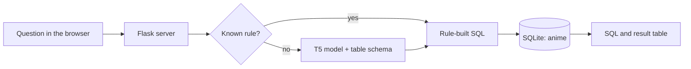

# AskSQL: Natural Language Queries over an Anime Database

AskSQL turns plain-English questions into SQL, runs the query against a local SQLite database, and shows both the generated SQL and the results in a web page. It combines a fine-tunable **T5-small** text-to-SQL model with a few deterministic rules for common question shapes.

**Live demo:** [Open AskSQL](https://contrast-adjacent-announced-triple.trycloudflare.com). The demo runs on a private server behind an HTTPS tunnel, so it is only available while that server is online and the address can change when the tunnel restarts. Results are limited to 500 rows.

## How it works



| Part | File | Role |
|---|---|---|
| Web app | `server.py`, `templates/index.html` | Serves the page and the `/query` API |
| Database | `src/database.py` | Builds SQLite from the CSV and runs queries |
| Inference | `src/inference.py` | Loads the model, applies rules, generates and cleans SQL |
| Data generation | `scripts/generate_synthetic.py` | Creates question/SQL training pairs for the anime table |
| Training | `scripts/train_model.py` | LoRA fine-tuning of T5-small, merged into a single model |
| Tests | `scripts/test_project.py` | Smoke tests for generation and the database |
| Notebook | `demo.ipynb` | Step-by-step walkthrough of the pipeline |

## Quick start

Python 3.10 or newer is recommended. The first run downloads the base model (`cssupport/t5-small-awesome-text-to-sql`) from Hugging Face, so it needs internet access.

```bash
git clone https://github.com/Nalluri-Prasanth/AskSQL.git
cd AskSQL
python -m venv .venv
source .venv/bin/activate        # Windows: .\.venv\Scripts\Activate.ps1
pip install -r requirements.txt

python -m src.database           # build project_db.sqlite from data/animenew.csv
python server.py                 # http://127.0.0.1:5000
```

Try questions such as:

* *List top 5 rated anime*
* *Show top 3 popular anime*
* *What is the story of One Piece?*
* *Show me action movies with rating above 8*

## Optional: fine-tune the model

```bash
python scripts/generate_synthetic.py    # writes data/train_processed.csv and data/dev_processed.csv
python scripts/train_model.py           # saves the merged model to models/avgs_t5_wikisql
python scripts/test_project.py          # smoke tests
```

When `models/avgs_t5_wikisql` exists the server uses it; otherwise it falls back to the base checkpoint. The generated data, trained model and database file are ignored by Git.

## Dataset

[`data/animenew.csv`](data/animenew.csv) holds 14,578 anime with 18 columns (title, media type, episodes, years, season, description, studios, tags, content warnings, audience counts, rating and votes). It is based on the [Kaggle Anime Rating dataset](https://www.kaggle.com/datasets/vishnujg/anime-rating); confirm its licence before redistributing it. The full column list is in the [project report](docs/PROJECT_REPORT.md#iii-dataset-and-database).

## API

| Method and path | Body | Response |
|---|---|---|
| `GET /` | none | Web interface with schema and a five-row preview |
| `POST /query` | `{"question": "..."}` | `{"sql": "...", "result_html": "..."}` or `{"sql": "...", "error": "..."}` |
| `POST /init_db` | none | Rebuilds the database from the CSV (deletes local changes) |

```bash
curl -X POST http://127.0.0.1:5000/query -H "Content-Type: application/json" -d '{"question":"List top 5 rated anime"}'
```

## Limitations

This is a local prototype, not a production service. Generated SQL is executed without a read-only connection or query allow-list, the server runs in Flask debug mode with no authentication, and no accuracy benchmark is published. The synthetic dev set overlaps the training set, so it is not an independent test. Run it locally or behind access controls, and read the full list in [Discussion](docs/PROJECT_REPORT.md#viii-discussion).

## Documentation

The [project report](docs/PROJECT_REPORT.md) covers the architecture, dataset schema, installation, training configuration, usage, testing, limitations and troubleshooting.

## Repository layout

```text
├── data/animenew.csv           # source dataset
├── docs/PROJECT_REPORT.md      # full project report
├── scripts/                    # data generation, training, tests
├── src/                        # database and inference modules
├── templates/index.html        # web interface
├── demo.ipynb                  # notebook walkthrough
├── server.py                   # Flask application
└── requirements.txt
```

## Author

Prasanth Nalluri ([@Nalluri-Prasanth](https://github.com/Nalluri-Prasanth))
