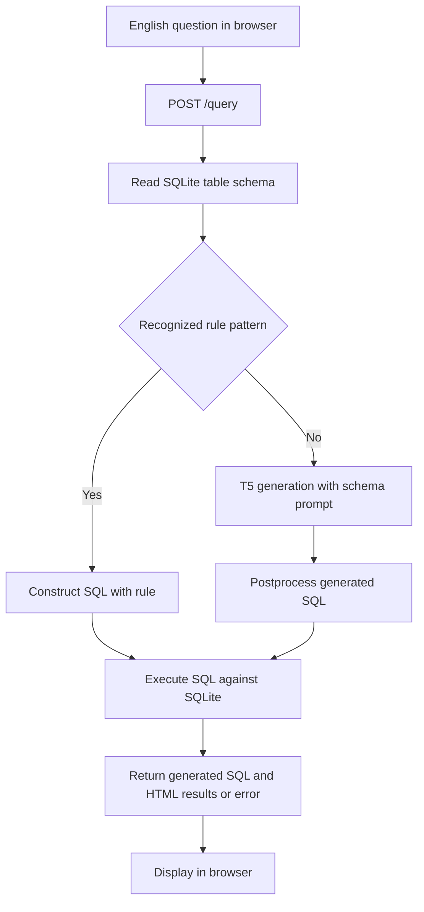

# AskSQL Project Report

**Anime Database Query System**  
**Author:** Prasanth Nalluri
**Repository:** [Nalluri-Prasanth/AskSQL](https://github.com/Nalluri-Prasanth/AskSQL)  
**Implementation reviewed:** `5cf05f7ed4295137684eea92ef24ab559ee34b45`

| Name | Contribution |
| --- | --- |
| Prasanth Nalluri | Project repository owner |

## Table of Contents

- [Abstract](#abstract)
- [I Introduction](#i-introduction)
- [II System Architecture](#ii-system-architecture)
- [III Dataset and Database](#iii-dataset-and-database)
- [IV Installation and Environment Setup](#iv-installation-and-environment-setup)
- [V Data Preparation and Model Training](#v-data-preparation-and-model-training)
- [VI Program Execution and Usage](#vi-program-execution-and-usage)
- [VII Testing and Evaluation](#vii-testing-and-evaluation)
- [VIII Discussion](#viii-discussion)
- [IX Conclusion](#ix-conclusion)
- [Acknowledgments](#acknowledgments)
- [References](#references)
- [Appendix](#appendix)

## Table of Tables

1. Component responsibilities
2. Dataset schema
3. Training configuration
4. HTTP interface
5. Troubleshooting

## Table of Figures

1. Question to result workflow

## Abstract

AskSQL is a Python application that turns English questions about an anime dataset into SQL queries and displays the results through a Flask web interface. It combines a T5 text-to-SQL model with explicit rules for selected question patterns. SQLite stores the anime records, while a synthetic data generator supplies question and SQL pairs for optional LoRA fine-tuning. The application exposes the generated SQL alongside its results, making the query process visible to the user. This report explains the implementation, local setup, training workflow, interfaces, testing approach, and current limitations. The repository provides a working implementation path but does not include trained weights or published accuracy measurements.

## I Introduction

### 1 Project purpose

Relational databases require users to express requests in SQL. AskSQL explores a natural language interface for a single anime table so that users can ask about titles, ratings, episodes, release years, studios, and descriptions without writing each query manually.

### 2 Objectives

- Import the supplied anime CSV into SQLite.
- Include the current table schema in model input.
- Translate questions into SQL through rules or model generation.
- Execute SQL and present readable tables in a browser.
- Support domain adaptation through synthetic examples and LoRA training.

### 3 Scope

The active application targets the `anime` table. It is a local demonstration and development project. General database connections, multi-table joins, authentication, and production deployment controls are not implemented. Legacy WikiSQL preprocessing is retained separately from the anime workflow.

## II System Architecture

### 1 Component responsibilities

**Table 1. Component responsibilities**

| Component | Source | Responsibility |
| --- | --- | --- |
| Web server | [`server.py`](../server.py) | Render the homepage, accept questions, return SQL and HTML results, reset the database |
| Database layer | [`src/database.py`](../src/database.py) | Import CSV or legacy JSONL and execute SQL |
| Inference engine | [`src/inference.py`](../src/inference.py) | Load a model, apply question rules, generate and postprocess SQL |
| Browser interface | [`templates/index.html`](../templates/index.html) | Submit JSON requests and display schema, preview, SQL, and results |
| Synthetic generator | [`scripts/generate_synthetic.py`](../scripts/generate_synthetic.py) | Build domain-specific training and development CSV files |
| Trainer | [`scripts/train_model.py`](../scripts/train_model.py) | Train LoRA parameters and save merged model weights |
| Smoke tests | [`scripts/test_project.py`](../scripts/test_project.py) | Check basic SQL generation and database retrieval |
| Notebook | [`demo.ipynb`](../demo.ipynb) | Alternative interactive project walkthrough |

### 2 Question to result workflow

**Figure 1. Question to result workflow**



### 3 Model selection and generation

`SQLGenerator` first tries `models/avgs_t5_wikisql`. If loading raises one of the handled exceptions, it downloads or loads the cached `cssupport/t5-small-awesome-text-to-sql` checkpoint. An explicit model path can also be passed to the constructor. CUDA is selected when available; otherwise inference uses the CPU.

Questions containing `story of`, `description of`, `plot of`, or `synopsis of` produce a description lookup rule. Questions matching `top N` can trigger ranking by rating, votes, episodes, or release year. Other questions use this prompt shape:

```text
tables: CREATE TABLE anime (column type, ...) query for: question
```

Model input is truncated at 512 tokens. Generation uses four beams and a maximum output length of 128 tokens. Postprocessing performs literal replacements for selected column synonyms, string comparisons, and SQL prefixes. These replacements are heuristics rather than SQL parsing.

## III Dataset and Database

### 1 Source and storage

The tracked source is [`data/animenew.csv`](../data/animenew.csv). The original README attributes it to the [Kaggle Anime Rating Dataset](https://www.kaggle.com/datasets/vishnujg/anime-rating). Dataset licensing and upstream provenance should be confirmed before redistribution beyond the existing project.

`init_database()` reads the CSV with pandas and writes table `anime` to `project_db.sqlite`. It strips surrounding column whitespace and replaces spaces, slashes, and hyphens with underscores. SQLite types are inferred by pandas; the homepage reads actual database types with `PRAGMA table_info`.

### 2 Dataset schema

**Table 2. Dataset schema**

| Columns | Meaning |
| --- | --- |
| `title`, `mediaType` | Anime name and release format |
| `eps`, `duration`, `ongoing` | Episode count, duration value, and ongoing flag |
| `startYr`, `finishYr`, `sznOfRelease` | Release years and season |
| `description` | Synopsis text |
| `studios`, `tags`, `contentWarn` | List-like text containing studios, categories, and warnings |
| `watched`, `watching`, `wantWatch`, `dropped` | Audience status counts |
| `rating`, `votes` | Dataset rating value and vote count |

The file contains 18 columns. Units and rating scale are not defined in the application. List-like fields are stored as text rather than separate relational tables. Missing values are retained through the import process; queries may need explicit NULL handling.

### 3 Database lifecycle

Database paths are relative to the working directory, so run commands from the repository root. `python server.py` initializes the database if the SQLite file is absent. Synthetic data generation does **not** initialize the database. Calling `init_database()` or `POST /init_db` deletes the existing database and rebuilds it from the CSV, discarding local changes.

## IV Installation and Environment Setup

### 1 Requirements

Use a Python environment compatible with the selected PyTorch, Transformers, and PEFT versions. No Python version or complete dependency lockfile is specified in the repository. Internet access is needed for uncached model and tokenizer downloads. A compatible GPU is optional; training duration depends on the environment.

### 2 Clone and create an environment

```bash
git clone https://github.com/Nalluri-Prasanth/AskSQL.git
cd AskSQL
python -m venv .venv
```

Windows PowerShell:

```powershell
.\.venv\Scripts\Activate.ps1
```

macOS or Linux:

```bash
source .venv/bin/activate
```

### 3 Install dependencies

```bash
python -m pip install --upgrade pip
python -m pip install -r requirements.txt
python -m pip install sentencepiece
```

The explicit `T5Tokenizer` commonly needs SentencePiece, which is absent from the repository requirements. Core dependencies include PyTorch, Transformers, PEFT, pandas, Flask, and Accelerate. Streamlit is listed but is not the frontend used by `server.py`. Most dependencies are unpinned, so record the resolved versions when establishing a reproducible environment.

### 4 Initialize the database

```bash
python -m src.database
```

This command rebuilds the database from the tracked CSV. It is unnecessary to train a model before trying the fallback checkpoint.

## V Data Preparation and Model Training

### 1 Generate anime training examples

```bash
python scripts/generate_synthetic.py
```

The script writes `data/train_processed.csv` and `data/dev_processed.csv`, each with `input_text` and `target_text`. Templates cover selection, media-type filters, tags, rankings, title details, and selected combined conditions.

The `num_samples` argument does not control the output size: examples come from fixed templates and small samples of titles, tags, and media types. No random seed is set. Development data is generated from the same template families and source dataset, including repeated fixed examples, so it is not an independent benchmark.

### 2 Fine-tune the model

```bash
python scripts/train_model.py
```

**Table 3. Training configuration**

| Setting | Value in source |
| --- | --- |
| Base checkpoint | `cssupport/t5-small-awesome-text-to-sql` |
| Epochs | 3 |
| Per-device training and evaluation batch size | 8 |
| Maximum input and target lengths | 512 and 128 tokens |
| LoRA rank and alpha | 8 and 32 |
| LoRA dropout | 0.1 |
| LoRA target modules | `q`, `v` |
| Warmup steps | 500 |
| Weight decay | 0.01 |
| Checkpoint saving | Each epoch, retain at most two checkpoints |
| Evaluation | Each epoch when development data exists |
| Final output | `models/avgs_t5_wikisql` |

Training merges LoRA weights into the base model before saving the final model and tokenizer. The script does not configure best-checkpoint selection. Its saved final model should not be described as a measured best model. A warmup of 500 steps may exceed the entire training run for this small dataset and should be reviewed before experiments.

### 3 Legacy preprocessing

`scripts/preprocess.py` processes WikiSQL-style JSONL files when supplied separately. Those files are not tracked. Its condition-bearing SQL is assembled with `WHERE` before `FROM`, which is invalid SQL. Use the anime synthetic generator for the documented active workflow; repair and validate the legacy converter before relying on it.

## VI Program Execution and Usage

### 1 Start the application

```bash
python server.py
```

Open [the local application](http://127.0.0.1:5000). The homepage shows the first five records and the database schema. Enter a question and select **Generate SQL**, or press Enter. Results appear below the generated query. Model loading occurs when the server module is imported, so startup can take time even for questions handled by rules.

### 2 Example questions

```text
List top 5 rated anime
Show top 3 popular anime
What is the story of One Piece?
List all anime titles
```

The first question has a deterministic rule that produces:

```sql
SELECT title, rating FROM anime ORDER BY rating DESC LIMIT 5
```

Description questions use a partial-title `LIKE` match and may return multiple records. Model-generated results vary with the loaded checkpoint. A complex question such as “top 5 rated action anime” triggers the rating rule but loses the action filter; users should inspect SQL before interpreting results.

### 3 HTTP interface

**Table 4. HTTP interface**

| Method and path | Input | Response behavior |
| --- | --- | --- |
| `GET /` | None | Render homepage, schema, and five-row preview |
| `POST /query` | JSON with `question` | Return `sql` and `result_html` on success |
| `POST /init_db` | No body required | Rebuild database and return a message |

Example query request:

```bash
curl -X POST http://127.0.0.1:5000/query -H "Content-Type: application/json" -d '{"question":"List top 5 rated anime"}'
```

For PowerShell, use:

```powershell
Invoke-RestMethod -Uri http://127.0.0.1:5000/query -Method Post -ContentType 'application/json' -Body '{"question":"List top 5 rated anime"}'
```

An empty question returns HTTP 400 with `error`. A database SQL error returns JSON containing `sql` and `error`, normally with HTTP 200. Exceptions caught inside query processing return HTTP 500. The route assumes a JSON object; malformed input is not comprehensively validated. Successful empty results return the HTML message `No results found.`

## VII Testing and Evaluation

### 1 Existing smoke tests

Run from the repository root:

```bash
python scripts/test_project.py
```

The test suite loads a model once and initializes the database when absent. It checks that generated SQL is nonempty and contains `SELECT`, then verifies that `SELECT * FROM anime LIMIT 1` returns a record. The generation test uses a dummy schema and does not execute its output. These tests do not establish semantic correctness, query safety, or generalization.

### 2 Evaluation procedure

For meaningful evaluation, create a held-out set of questions paired with reviewed SQL and expected results. Include filtering, aggregation, title punctuation, missing values, mixed conditions, and unsupported requests. Keep templates and examples separate from training, and report execution accuracy, SQL validity, and latency. Compare rule-handled requests with model-handled requests separately.

No benchmark scores, training logs, screenshots of execution, or measured speed claims are supplied in this report. Documentation review does not establish that model training or the full application has passed in a new environment.

## VIII Discussion

### 1 Implementation strengths

The project separates database access, inference, training, and presentation into small modules. Schema prompts provide table context, LoRA supplies an efficient adaptation mechanism, and explicit rules make selected common questions predictable. Displaying SQL helps users identify whether the system interpreted a question correctly.

### 2 Current limitations

- Rules can discard extra filters. Description rules directly interpolate titles, so apostrophes can break SQL and untrusted values require safe handling.
- Generated SQL is executed without a read-only connection, statement allowlist, query timeout, or result-size cap. Treat the application as a local prototype until those controls exist.
- The server enables Flask debug mode and has no authentication. Database reset is unauthenticated.
- Error messages are inserted into browser HTML without escaping, creating an additional concern for untrusted deployments.
- Synthetic data uses `eval()` to parse tag strings. Use only trusted source data until it is replaced with safe parsing.
- Global text substitutions can change SQL meaning, including replacing `COUNT(rating)` with `rating`.
- Training and development examples overlap, and label padding is not explicitly masked to `-100` in the dataset implementation. Review the training objective and evaluation split before reporting performance.
- Dependencies and model revisions are not pinned. Deprecated tokenizer and Trainer interfaces may require a compatible Transformers release or code updates.

### 3 Troubleshooting

**Table 5. Troubleshooting**

| Symptom | Likely cause and action |
| --- | --- |
| Missing CSV or no anime table | Confirm the working directory and tracked CSV, then run `python -m src.database` |
| Local model fails to load | The engine attempts fallback; check network access, cache availability, and the reported model path |
| Tokenizer dependency error | Install SentencePiece in the active environment and restart the process |
| Missing processed training data | Run `python scripts/generate_synthetic.py` before training |
| Trainer or tokenizer API error | Check installed library versions against the APIs used in the training script |
| Empty results | Inspect the SQL, actual column values, title spelling, and NULL values |
| Incorrect ranking or ignored filter | Check whether a broad ranking rule intercepted the question |
| Out of GPU memory | Reduce batch size in the training script or use an environment with more memory |

### 4 Future improvements

Priorities are read-only SQL execution, validated statements and input, safe string handling, independent evaluation data, dependency pinning, and integration tests that compare results with reference queries. Subsequent improvements could add explicit filter composition, a normalized tag schema, model revision tracking, and deployment configuration with authentication and debug mode disabled.

## IX Conclusion

AskSQL demonstrates how a schema-aware text-to-SQL model, a small set of rules, SQLite, and Flask can provide a natural language interface to anime records. The repository includes the data preparation and fine-tuning path needed to explore domain adaptation. Its present value is as an inspectable local prototype; trustworthy broader use depends on stronger query controls, reproducible dependencies, and independent evaluation of generated results.

## Acknowledgments

The implementation builds on open-source work from the PyTorch, Hugging Face Transformers, PEFT, Flask, pandas, and SQLite communities. The existing README credits the Kaggle anime dataset linked below.

## References

Implementation sources are linked in Table 1 and define the behavior described in this report. External links are provided for further reading.

1. [AskSQL repository](https://github.com/Nalluri-Prasanth/AskSQL)
2. [Anime Rating Dataset attributed in the original README](https://www.kaggle.com/datasets/vishnujg/anime-rating)
3. [Text-to-SQL checkpoint](https://huggingface.co/cssupport/t5-small-awesome-text-to-sql)
4. [Transformers documentation](https://huggingface.co/docs/transformers/index)
5. [PEFT documentation](https://huggingface.co/docs/peft/index)
6. [Flask documentation](https://flask.palletsprojects.com/)
7. [SQLite documentation](https://www.sqlite.org/docs.html)
8. [pandas documentation](https://pandas.pydata.org/docs/)

## Appendix

### A Repository structure

```text
AskSQL/
|-- data/animenew.csv
|-- docs/PROJECT_REPORT.md
|-- scripts/
|   |-- generate_synthetic.py
|   |-- preprocess.py
|   |-- test_project.py
|   `-- train_model.py
|-- src/
|   |-- __init__.py
|   |-- database.py
|   `-- inference.py
|-- templates/index.html
|-- demo.ipynb
|-- requirements.txt
|-- server.py
`-- README.md
```

### B Generated artifacts

`project_db.sqlite`, model weights under `models/`, training logs, and processed CSV files are generated locally and ignored by Git. A fresh clone contains neither a trained custom checkpoint nor processed training files.

### C Common command sequence

After installing dependencies in the activated environment, a fallback-model demonstration needs:

```bash
python -m src.database
python server.py
```

For optional fine-tuning, stop the server and run:

```bash
python scripts/generate_synthetic.py
python scripts/train_model.py
python scripts/test_project.py
python server.py
```

### D Template correspondence

This report follows the supplied assignment report organization: cover details, contents, lists of tables and figures, abstract, introduction, setup and execution sections, discussion, conclusion, acknowledgments, references, and appendix. Section topics describe AskSQL. GitHub anchors replace printed page numbers, and the architecture diagram replaces unrelated assignment screenshots.
